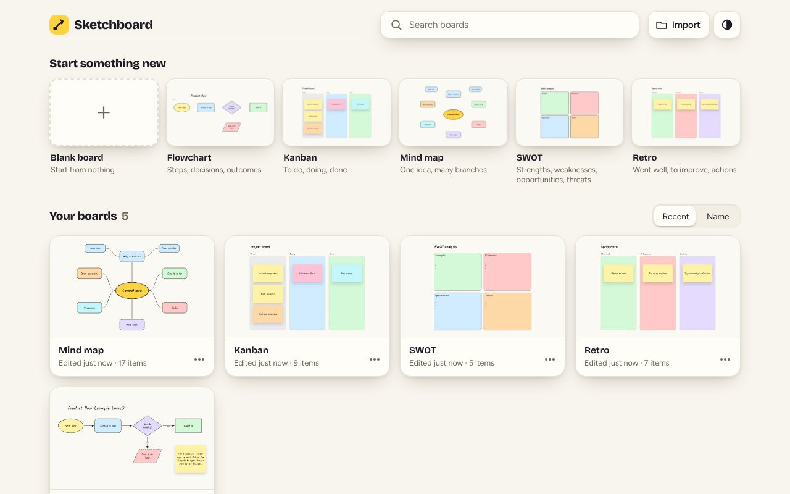
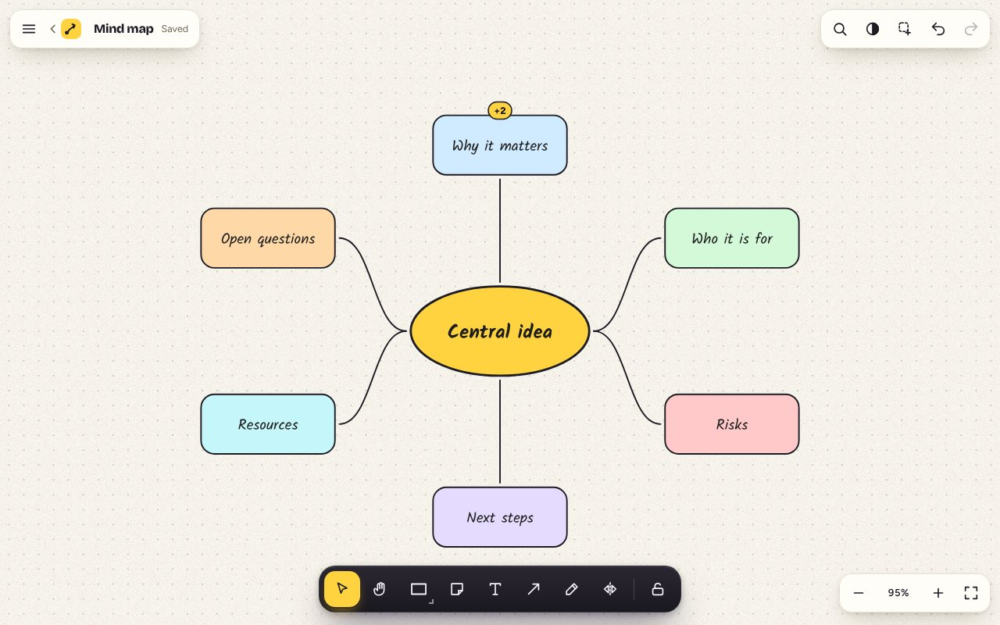
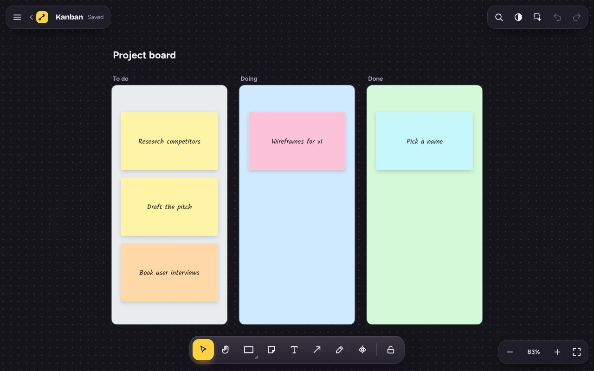
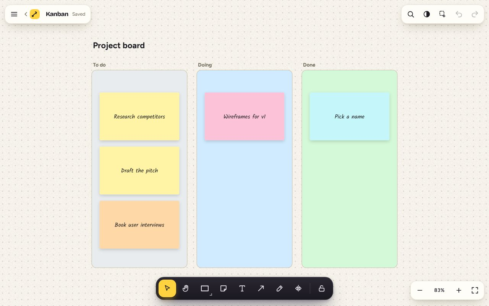
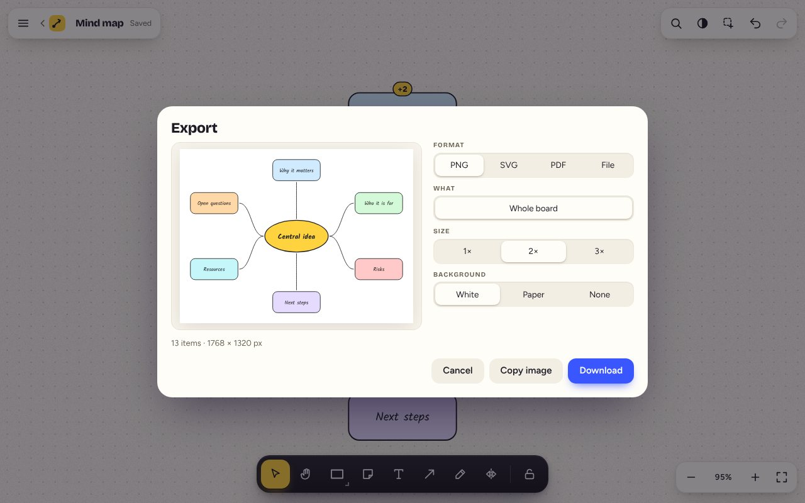
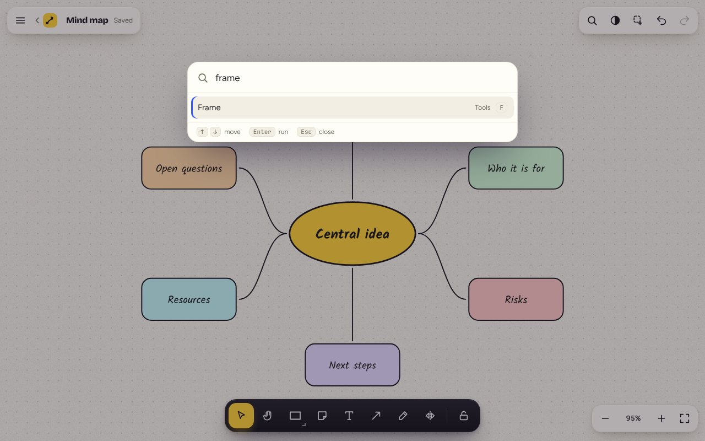
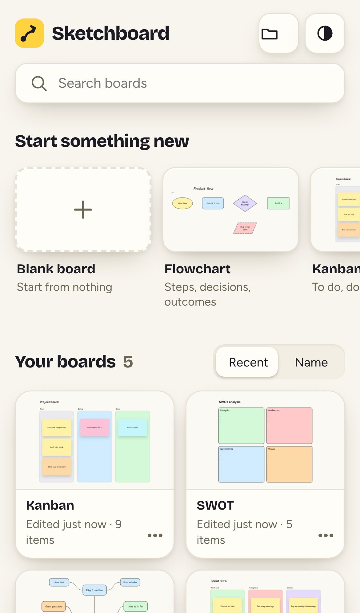
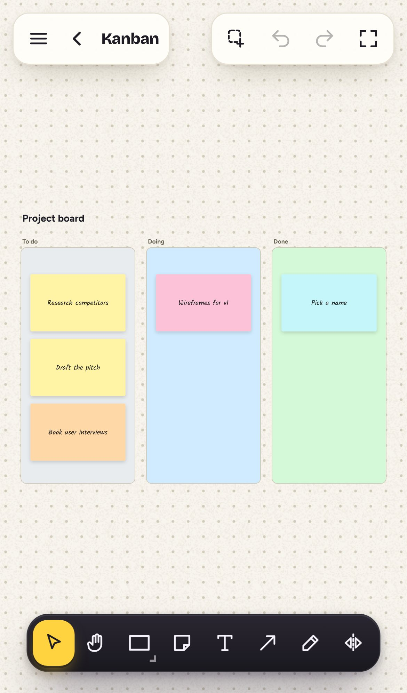

# Sketchboard

A whiteboard and diagram app that lives in your browser. No account, no server, and no build step. Your boards stay on your device and work offline. Install it like an app on your phone or computer.



## What it does

**Boards**
- Keep as many boards as you like on a home screen with live thumbnails, search and sort
- Start from a template: blank, flowchart, kanban, mind map, SWOT or retro
- Rename, duplicate or delete a board (Undo is there if you delete by mistake), and import or download board files

**Mind maps**
- Start from the Mind map template, or select any shape and press **Mind map root** in the selection bar. Add branches with the blue + dots
- Branches style themselves by depth: the central idea is largest, each level is a little smaller (26 → 20 → 16 → 14 px), every main branch gets its own color and its sub-branches keep it
- Fold a branch away with the **−** button on the node (or Ctrl/⌘ + /). A yellow **+N** badge shows how much is hidden. Collapsed state is saved with the board
- Folded branches are still part of the node: moving, copying or deleting it takes the whole branch along. PNG, SVG and PDF show what you see; board files and share links keep everything

**Drawing**
- 11 shapes, sticky notes, text, a freehand marker, and images (paste, drag in, or insert). Each shape type starts with its own color and font size, sized so a short label fits; restyle one type and later shapes of that type follow
- Connectors stay attached when you move things: curved, 90° elbow, rounded elbow or straight, with four arrowhead styles
- **Frames** are titled areas. Drag a frame and everything inside it comes along. They export as separate pages or images
- **Groups** (Ctrl+G) and **locking** (Ctrl+Shift+L)
- Symmetry mode snaps to centres, edges and equal gaps. Align, distribute and match-size tools are included

**Finding your way**
- **Command palette** (Ctrl/⌘+K) runs any command and jumps to a board or frame
- Right-click (or long-press on a phone) for a context menu
- Minimap (N), zoom to selection (Shift+2), zoom to fit (Shift+1)

**Sharing and export**
- Export PNG (1×–3×, white, paper or transparent background), SVG with its fonts embedded, PDF with one page per frame, or a board file
- Export the whole board, just the selection, or a single frame
- Copy as an image straight to the clipboard (Ctrl+Shift+C)
- **View-only share links**: the board is compressed into the link itself, so nothing is uploaded. Whoever opens it can save their own copy

**App**
- Installable (PWA), works fully offline, light and dark themes, touch-friendly on phones and tablets

| | |
| --- | --- |
|  |  |
|  |  |
|  |  |

<p>
  
  
</p>

## Keyboard shortcuts

| Keys | Does |
| --- | --- |
| V · H · R · O · D · S · T · A · P · F | Select, hand, rectangle, ellipse, diamond, sticky, text, connector, marker, frame |
| Ctrl/⌘ + K | Command palette |
| Ctrl/⌘ + Z / Shift + Z | Undo / redo |
| Ctrl/⌘ + C / X / V / D | Copy, cut, paste, duplicate |
| Ctrl/⌘ + G / Shift + G | Group / ungroup |
| Ctrl/⌘ + Shift + L | Lock |
| Ctrl/⌘ + / | Collapse / expand the selected mind-map branch |
| Ctrl/⌘ + Shift + E | Export |
| Ctrl/⌘ + Shift + C | Copy as image |
| Shift + 1 / Shift + 2 | Zoom to fit / zoom to selection |
| [ and ] | Send to back / bring to front |
| M · G · N · Q | Symmetry mode, grid, minimap, keep tool active |
| Enter | Edit the selected item's text |
| ? | All shortcuts and gestures |

## Where your data lives

Boards are saved in this browser's IndexedDB on this device, including images (each image is stored once, however many boards use it). Nothing is sent anywhere. To move a board to another device, download its board file or send a share link. Clearing site data for the page deletes your boards. The home screen shows how much space you're using.

Boards from the earlier single-board version are moved over automatically as "My first board".

## Running it locally

```bash
bash tests/serve.sh          # serves on http://127.0.0.1:8765
node tests/smoke.mjs         # end-to-end checks in headless Chromium (desktop + phone)
```

Opening `index.html` straight from disk also works, without offline mode. The tests use the Playwright package, which needs to be installed.

## Project layout

```
index.html          markup only
css/app.css         styles (design tokens at the top)
css/fonts.css       self-hosted fonts (fonts/, OFL / Apache licensed)
js/core.js          shared state and constants (loaded first)
js/actions.js       every command once: drives shortcuts, menu, palette, context menu, help
js/store.js         IndexedDB storage      js/boards.js   board lifecycle + router
js/home.js          home screen            js/templates.js starter boards
js/power.js         frames, groups, lock, images, context menu, minimap
js/mindmap.js       mind-map trees, collapse / expand, depth styling
js/export.js        PNG/SVG/PDF engine     js/share.js    export dialog + share links
js/palette.js       command palette        js/pwa.js      offline + install
sw.js               service worker (keep PRECACHE in sync; the smoke test checks it)
tools/              regenerate icons and README screenshots
```

The scripts are plain `<script>` files that share one global scope, loaded in the order in `index.html`. There's no bundler. Format code with Prettier (`.prettierrc.json`).

## Limits worth knowing

- No live collaboration or accounts. That would need a server, and keeping everything local is the point.
- Share links can't carry images, and very large boards make long links. Send a board file for those.
- PDF export goes through the browser's print dialog ("Save as PDF").
